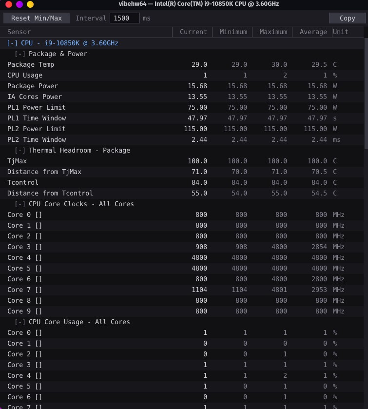

# vibehw64

A lightweight, HWiNFO64-style **hardware sensor monitor for Linux** — one self-contained
binary, no installer, no config files, no background service.



---

## What it is

vibehw64 is the "Sensors window" half of HWiNFO64, rebuilt for Linux. It shows live readings
from your CPU, memory, GPU, drives and network interfaces in a collapsible tree, with
**Current / Minimum / Maximum / Average** for every sensor and a one-key reset.

It is deliberately small: one executable, a font and icon compiled in, and a handful of
`sysfs` / `/proc` reads every 1.5 seconds. The sampler is designed to stay well under 1% of
one CPU core at the default interval.

## Requirements

- **Linux x86-64**
- **glibc ≥ 2.44** — this binary is built against a current Arch/Garuda toolchain
- The usual desktop graphics libraries:
  `libGL`, `libX11`, `libXrandr`, `libXinerama`, `libXcursor`, `libXi`, `libXfixes`,
  `libwayland-client`, `libwayland-cursor`, `libwayland-egl`, `libxkbcommon`
- Kernel support for `hwmon`, `powercap`, `nvme` (all standard)

You do **not** need raylib, Odin, or any runtime config. raylib is compiled into the binary,
and the UI font and window icon are embedded in it.

## Running it

```sh
chmod +x vibehw64
./vibehw64
```

The window is resizable; `760 × 820` is the default size.

### First run — the setup banner

Two kernel interfaces are root-only by default:

| Interface | Why it is locked down |
| --- | --- |
| `/sys/class/powercap/*/energy_uj` | RAPL energy counters, mode `0400 root` |
| `/sys/firmware/dmi/tables/DMI` | SMBIOS table, mode `0400 root` |

Without them, package/core **power** reads `[Root Required]` and **memory speed / SMBIOS
nominal voltage** show `--`. Everything else works fine.

On first launch a banner appears:

> Power and memory detail need one-time setup   **[ Set up ]**

Click **Set up**. Your desktop's standard authentication dialog (polkit) asks for your
password. vibehw64 never sees or handles it — the password goes to polkit, not to the app.

After authenticating, the app installs a udev rule and a small oneshot systemd unit,
reloads both, and **repopulates itself in place — no restart**. The changes persist across
reboots. Memory speed/nominal voltage and package power refill immediately; the per-DIMM capacity
rows and `Installed Capacity` are created at launch, so they appear on the next start.

If you would rather not use the in-app button, the same setup is available as a script:

```sh
sudo scripts/install-permissions.sh
```

and can be removed again with:

```sh
sudo scripts/install-permissions.sh --uninstall
```

## What the sections show

| Section | Contents |
| --- | --- |
| **CPU** | *Package & Power*: package temperature, package/core usage, package and IA-core power, PL1/PL2 limits and their time windows. *Thermal Headroom - Package*: TjMax and Tcontrol with distance from each. Then *CPU Core Clocks*, *CPU Core Usage* and *CPU Core Temperatures* per group, and per-core **Distance from TjMax / Tcontrol** with the actual limits in the subsection headers. |
| **Memory** | *Usage*: installed capacity, usable total, physical used/available/load, virtual (commit) used/available/load, swap used/total/load. *Modules*: configured speed, SMBIOS nominal voltage, per-DIMM capacity/speed/locator. *Temperatures*: per-DIMM SPD sensors where exposed. |
| **GPU (AMD)** | edge/junction/memory temperature, PPT power, fan RPM, sclk, mclk, vddgfx, GPU usage, and VRAM used/total. The title uses the subsystem model when `pci.ids` knows it (e.g. `Nitro+ Radeon RX 570/580/590`). |
| **CPU & Board Voltages** | every non-GPU `hwmon` voltage input that exists (empty if no Super I/O driver) |
| **one per drive** | model + type, NVMe temperatures, capacity, used %, free |
| **one per NIC** | Ethernet: link speed + utilisation; Wi-Fi: SSID in the title, signal in dBm |
| **Other Sensors** | the remaining `hwmon` long tail: ACPI zones, NIC PHY/MAC temperatures, Wi-Fi temperature, board Super I/O temperatures and fans |

Sections with nothing to show are hidden rather than shown empty, and empty groups inside a
section are skipped too.

## Where the numbers come from

Nothing is scraped from other tools, and nothing is estimated. Every value is read from the
kernel, a firmware table, or (for GPU marketing names) the distribution's `pci.ids`:

| Reading | Source |
| --- | --- |
| CPU core clocks | `cpuinfo_max_freq` once, then `cpufreq/scaling_cur_freq` |
| CPU core / package temperatures | `hwmon` `coretemp` — `tempN_input` + `tempN_label` |
| TjMax / Tcontrol and distance | `coretemp` `tempN_crit` / `tempN_max`, subtracted from the live temperature |
| CPU usage (per core and package) | `/proc/stat` counter deltas |
| Package / IA-core power | `powercap` `energy_uj` deltas over elapsed time |
| PL1 / PL2 and their time windows | `powercap` `constraint_N_power_limit_uw` / `constraint_N_time_window_us` |
| CPU core count, P/E or CCD grouping | `cpu_core`/`cpu_atom` cpumasks (Intel), `cache/index3/shared_cpu_list` (AMD) |
| Memory speed, part number, installed/per-DIMM capacity | SMBIOS type 17 (configured speed preferred over rated; size, locator) |
| DIMM temperatures | `hwmon` `spd5118` (or `jc42`) |
| Memory usage, commit and swap | `/proc/meminfo` (`MemTotal`, `MemAvailable`, `Committed_AS`, `CommitLimit`, swap) |
| SMBIOS nominal voltage | SMBIOS type 17 configured-voltage field — **a firmware value, not a live rail** |
| GPU temperatures / power / clocks / fan | `hwmon` `amdgpu` |
| GPU utilisation / VRAM | `drm/cardN/device/gpu_busy_percent`, `mem_info_vram_used/total` |
| GPU marketing name | `/usr/share/hwdata/pci.ids` keyed by vendor:device:subsystem, falling back to vendor:device |
| Drive model, size, type | `/sys/class/block`, `/sys/class/nvme` |
| Drive temperatures | `hwmon` `nvme`; SATA only if the `drivetemp` module is loaded |
| Drive used / free | `statfs` on the first filesystem mounted from that drive |
| NIC link speed | `/sys/class/net/<if>/speed` |
| NIC utilisation | `/proc/net/dev` byte deltas over the interval |
| Wi-Fi SSID | `SIOCGIWESSID` ioctl |
| Wi-Fi signal | `/proc/net/wireless` |
| Other temperatures / fans | unclaimed `hwmon` `temp*_input` / `fan*_input` |
| Short CPU name | `/proc/cpuinfo` brand string, vendor decoration stripped |

Linux has no exact equivalent of Windows "virtual memory". The Virtual Memory rows use
**commit charge** (`Committed_AS` / `CommitLimit`), which is the closest analogue; Swap is
reported separately so both are visible.

## Temperature highlighting

Measured temperature rows use per-cell bands:

| Cell value | Highlight |
| --- | --- |
| below 60 °C | unchanged |
| 60.0–69.9 °C | green box, white text |
| 70.0–79.9 °C | orange box, white text |
| 80.0 °C+ | red box, white text |

Current, Minimum, Maximum and Average are evaluated independently, so a row can show a
green Current, no Minimum box, a green Maximum and an uncoloured Average. Distance rows and
the static TjMax/Tcontrol limits are excluded.

## Controls

| Action | How |
| --- | --- |
| Copy the current snapshot | **Copy** button; every section/group/row is copied as aligned text, including collapsed sections |
| Scroll the list | mouse wheel, drag the scrollbar, or click the scrollbar track |
| Collapse / expand | click a section or group header |
| Resize a column | drag the divider between two column headers |
| Auto-fit a column | double-click its divider |
| Change poll interval | click the interval field, type a value in ms, press Enter (Esc reverts) |
| Reset Min/Max/Average | `Reset Min/Max` button, or press `R` |

The interval accepts **whole milliseconds only**, default `1500`. Lower values give sharper
peaks; higher values are gentler on the machine.

Column widths persist for the session. Growing the window widens the sensor column so the
table keeps filling it.

## Permissions and privacy

The setup step writes exactly two files:

```
/etc/udev/rules.d/99-vibehw64-power.rules            # chmod 0444 on powercap energy_uj
/etc/systemd/system/vibehw64-dmi-perms.service       # chmod 0444 on the DMI table at boot
```

Both are narrow: they change the mode of two specific files and nothing else. Neither grants
vibehw64 itself any privilege — the app always runs as your user.

**Privacy note:** the SMBIOS table includes your system UUID and hardware serial numbers.
Making it readable means any local user can read those. That is the same information
`dmidecode` shows, and it is what enables the memory speed readout. If you would rather not
expose it, run with the DMI rule absent — memory speed shows `--` (or the SPD JEDEC value on
DDR5 modules whose SPD hub is exposed) and the app works normally otherwise.

## Troubleshooting

| Symptom | Cause / fix |
| --- | --- |
| Power shows `[Root Required]` | Setup not done. Click **Set up**, or run `sudo scripts/install-permissions.sh`. |
| Power shows `--` for ~3 s after start | Expected — RAPL power needs two energy readings. |
| Memory Speed / SMBIOS Nominal Voltage show `--` | DMI table unreadable — same setup step. |
| Memory shows a `(JEDEC)` suffix | Only the SPD fallback is available; SMBIOS was unreadable. |
| `SMBIOS Nominal Voltage` says 1.200 V but BIOS VDIMM is higher | The SMBIOS configured-voltage field is firmware nominal data, not a measurement. Use the board's own sensor or BIOS if you need the live rail. |
| Virtual Memory Load is high while physical load is low | Expected: virtual rows use commit charge (allocated address space), not physical RAM. Check Swap separately. |
| TjMax/Tcontrol subsections missing | No `coretemp` `crit`/`max` values — normally an AMD CPU or a platform without those sensors. |
| No **CPU & Board Voltages** section | No Super I/O (`nct6775`/`it87`) driver bound. This is a board limitation. |
| No **Other Sensors** section | No unclaimed `hwmon` temperatures/fans are exposed by this board. |
| Wi-Fi temperature shows `--` | The radio is idle/disassociated and the driver is not reporting a value. |
| SATA drive has no temperature | Load the `drivetemp` module: `sudo modprobe drivetemp`. |
| Wi-Fi title says `disconnected` | Radio is down. When connected it shows the SSID. |
| Per-DIMM/Installed Capacity rows missing after setup | They are created at launch; restart the app once after the setup step. |
| Window looks blurry / scaled oddly | HiDPI scaling under Wayland. Report it — it is a known weak spot. |
| `no display available` on launch | No usable `DISPLAY`/`WAYLAND_DISPLAY`. Use `vibehw64 --probe` or `--snapshot` for headless output. |

## Headless / scripting

```sh
./vibehw64 --probe                       # 3 samples, topology + all statistics, exits
./vibehw64 --probe --ticks 10 --interval 500
./vibehw64 --snapshot                    # same text the Copy button produces, then exits
./vibehw64 --snapshot --ticks 2 --interval 300
```

`--probe` prints the discovered topology, every section and every sensor's
current/minimum/maximum/average, then exits non-zero if nothing was discovered. `--snapshot`
prints the aligned copied-text form and exits.

## Building from source

Requirements: **Odin** (`dev-2026-10` was used), `gcc`, `make`, `git`, and the X11/GL/Wayland
development headers.

```sh
# 1. Build and install the static raylib archive that Odin's vendor bindings expect.
#    Needed because the bindings target raylib 6.0 while distros ship 6.2, and the
#    Odin vendor tree contains no x86-64 static archive.
sudo scripts/build-raylib-static.sh

# 2. Build the binary.
./build.sh          # -> bin/vibehw64

# 3. Optional: the probe build used for development.
odin build src -debug -out:bin/vibehw64-debug
```

`scripts/build-raylib-static.sh` clones raylib 6.0 into `temp/raylib-6.0` and installs the
static archive into Odin's vendor tree. `build.sh` links raylib statically, so the resulting
binary has no `libraylib` dependency:

```
libc, libm, libGL, libX11 + X extensions, libwayland-*, libxkbcommon
```

`bin/` and `temp/` are build output/scratch, not source.

### Regression fixtures

```sh
python3 tests/run-fixtures.py
```

The script synthesizes an AMD 5950X-style tree (two CCDs, one `[3D]`), an Intel 12600K-style
frequency-fallback tree (no PMU masks), and a small SMBIOS blob for per-DIMM testing. It
runs `--probe --sys-root` against both and reports pass/fail. No static fixture tree is
checked in; the generated trees are discarded unless `--keep` is passed.

## Credits

- **raylib** — zlib licence — compiled into the binary
- **DejaVu Sans Mono** — Bitstream Vera licence — embedded; see
  `src/assets/LICENSE-DejaVu.txt`
- **Odin** — the language and `vendor:raylib` bindings
- GPU names come from the distro's `pci.ids` (`hwdata`), when present
- The vibehw64 V icon is an original mark inspired by HWiNFO64's visual language, and vibehw64 is not affiliated with HWiNFO or REALiX s.r.o.
